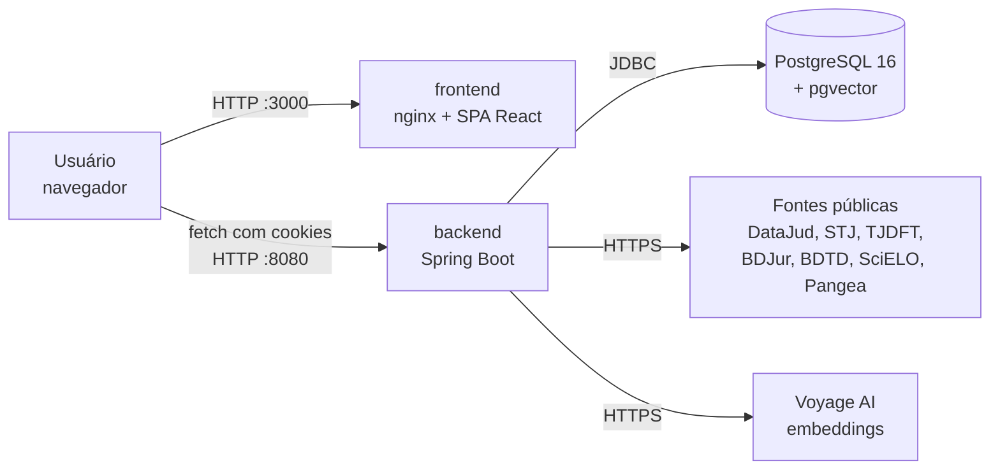
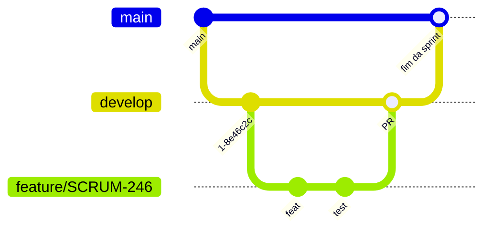
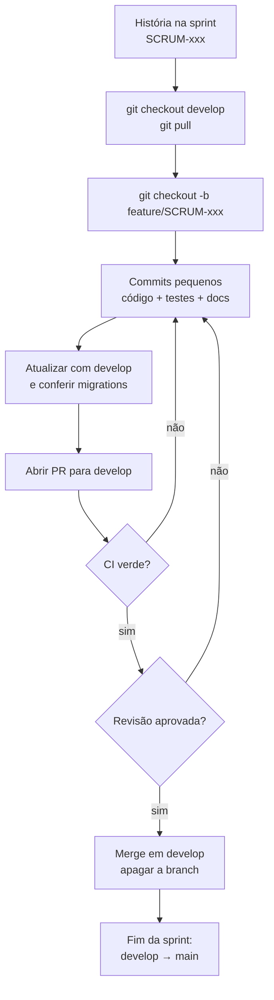
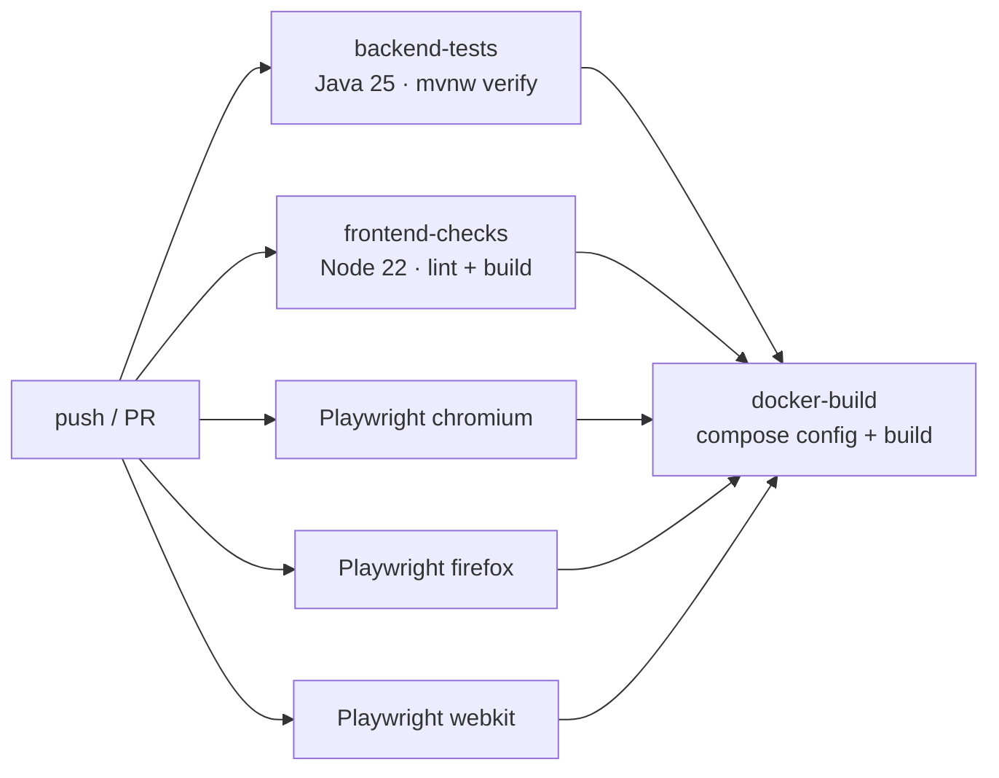
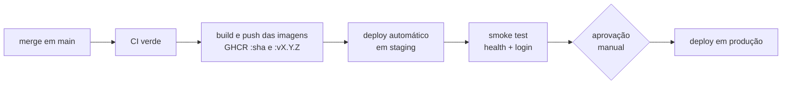

# WikiLaw: documentação técnica para DevOps

Documento de referência do projeto **WikiLaw** para o time de DevOps: arquitetura, ambientes, configuração, pipeline de CI, processos de desenvolvimento e pontos de atenção para levar o sistema a um ambiente hospedado.

> **Repositório da aplicação:** https://github.com/Forge-Fatec/wikilaw (monorepo `backend/` + `frontend/`)
> **Repositório de documentação:** https://github.com/Forge-Fatec/wikilaw-docs
> **Atualizado em:** 23/10/2026, com base na branch `feature/SCRUM-246`

## Sumário

1. [Visão geral](#1-visão-geral)
2. [Arquitetura](#2-arquitetura)
3. [Stack e versões](#3-stack-e-versões)
4. [Estrutura do repositório](#4-estrutura-do-repositório)
5. [Ambiente local](#5-ambiente-local)
6. [Configuração e variáveis de ambiente](#6-configuração-e-variáveis-de-ambiente)
7. [Banco de dados e migrations](#7-banco-de-dados-e-migrations)
8. [Segurança e autenticação](#8-segurança-e-autenticação)
9. [API: visão dos endpoints](#9-api-visão-dos-endpoints)
10. [Processos em segundo plano](#10-processos-em-segundo-plano)
11. [Integrações externas](#11-integrações-externas)
12. [Processo de desenvolvimento](#12-processo-de-desenvolvimento)
13. [Testes](#13-testes)
14. [Integração contínua (CI)](#14-integração-contínua-ci)
15. [Qualidade de código: SonarQube](#15-qualidade-de-código-sonarqube)
16. [Imagens Docker](#16-imagens-docker)
17. [Preparação para deploy](#17-preparação-para-deploy)
18. [Operação e troubleshooting](#18-operação-e-troubleshooting)
19. [Pendências e riscos conhecidos](#19-pendências-e-riscos-conhecidos)
20. [Referências](#20-referências)

---

## 1. Visão geral

O WikiLaw é uma plataforma de pesquisa jurídica desenvolvida como projeto acadêmico da FATEC São José dos Campos. Ele reúne **jurisprudência, precedentes e doutrina** de fontes públicas num banco único e oferece:

- busca textual por categoria (decisões, precedentes, doutrina) com filtros e paginação;
- busca semântica por similaridade de vetores (pgvector + embeddings da Voyage AI);
- dashboard com indicadores e gráficos sobre os resultados;
- exportação dos resultados em PDF;
- login com perfis `ADMIN` e `USER` e administração de usuários.

O acervo é carregado por coletores que consultam APIs e portais públicos (DataJud/CNJ, STJ, TJDFT, BDJur, BDTD, SciELO, Pangea/BNP). A carga roda em segundo plano dentro do próprio backend, com progresso persistido no banco.

### Situação atual

| Item | Situação |
| --- | --- |
| Integração contínua | Implementada (GitHub Actions) |
| Entrega/implantação contínua | Não implementada |
| Ambiente hospedado (staging/produção) | Não existe; o sistema roda via Docker Compose local |
| Registry de imagens | Não existe; as imagens só são construídas no CI |
| Observabilidade (métricas, logs centralizados) | Não implementada |

---

## 2. Arquitetura



Pontos importantes para infraestrutura:

- **O navegador chama o backend diretamente.** O nginx do frontend só serve arquivos estáticos; não há proxy reverso para `/api`. A URL do backend é fixada no bundle em tempo de build (`VITE_API_BASE_URL`, padrão `http://localhost:8080`).
- Por isso o backend precisa de **CORS** liberado para a origem do frontend e aceita credenciais (cookies de sessão).
- O backend é um **monólito** que expõe a API REST, executa as migrations na subida e roda os workers de importação e de embeddings.
- O banco é PostgreSQL com a extensão **pgvector** (índice HNSW para a busca semântica).

### Camadas do backend

```text
controller  → recebe HTTP, valida entrada (DTOs em dto/)
service     → regras de negócio, busca, dashboard, PDF, workers
integration → clientes das fontes externas e do provedor de embeddings
repository  → Spring Data JPA
entity      → mapeamento JPA (schema criado pelo Flyway, validado pelo Hibernate)
config      → segurança, CORS, propriedades tipadas
```

---

## 3. Stack e versões

| Camada | Tecnologia | Versão |
| --- | --- | --- |
| Linguagem backend | Java (Temurin) | 25 |
| Framework backend | Spring Boot (Web MVC, Data JPA, Security, Validation) | 4.1.1 |
| Build backend | Maven (wrapper `mvnw`) | 3.9.x |
| Migrations | Flyway | gerenciado pelo Spring Boot |
| Documentação da API | springdoc-openapi (Swagger UI) | 3.1.0 |
| PDF | Apache PDFBox | 3.0.8 |
| Banco | PostgreSQL + pgvector (`pgvector/pgvector:pg16-trixie`) | 16 |
| Banco de testes | H2 em memória (modo PostgreSQL) | gerenciado pelo Spring Boot |
| Cobertura | JaCoCo | 0.8.15 |
| Linguagem frontend | TypeScript | ~6.0 |
| Framework frontend | React | 19 |
| Build frontend | Vite | 8 |
| Gráficos | Recharts | 3 |
| Lint | ESLint | 10 |
| Testes E2E | Playwright | 1.62.1 |
| Runtime de build frontend | Node.js | 22 |
| Servidor web do frontend | nginx (`nginx:alpine`) | latest alpine |
| Análise estática | SonarQube Community | latest community |
| CI | GitHub Actions, runner `ubuntu-24.04` | — |

---

## 4. Estrutura do repositório

```text
wikilaw/
├── .github/
│   ├── workflows/ci.yml        # pipeline de CI
│   └── README.md               # resumo do fluxo de CI
├── backend/
│   ├── Dockerfile              # build multi-stage (Maven → JRE 25)
│   ├── pom.xml
│   ├── mvnw / mvnw.cmd
│   └── src/
│       ├── main/java/forge/wikilaw/backend/
│       ├── main/resources/
│       │   ├── application.properties
│       │   ├── db/migration/   # V1 … V14 (Flyway)
│       │   └── fonts/          # fontes usadas no PDF
│       └── test/               # JUnit + H2 (63 classes de teste)
├── frontend/
│   ├── Dockerfile              # build multi-stage (Node 22 → nginx)
│   ├── package.json / package-lock.json
│   ├── playwright.config.ts
│   ├── src/                    # React + TypeScript
│   └── tests/                  # Playwright (*.spec.ts)
├── docs/                       # guias técnicos por funcionalidade
├── docker-compose.yml          # postgres, backend, frontend, sonarqube
├── sonar-analysis.sh           # análise SonarQube em container
└── .env.example                # modelo das variáveis de ambiente
```

---

## 5. Ambiente local

### 5.1 Pré-requisitos

| Ferramenta | Para quê |
| --- | --- |
| Docker + Docker Compose | Obrigatório. Sobe banco, backend e frontend |
| Git | Obrigatório |
| Node.js 22 | Opcional. Desenvolvimento do frontend com hot reload e Playwright |
| JDK 25 | Opcional. Sem JDK local, o build e os testes do backend rodam em container (ver 5.4) |

### 5.2 Subir o sistema completo

```bash
cp .env.example .env          # PowerShell: Copy-Item .env.example .env
# edite o .env: no mínimo POSTGRES_PASSWORD
docker compose up --build -d postgres backend frontend
```

> Sem nomear os serviços, `docker compose up` também sobe o SonarQube e o banco dele, que consomem bastante memória. Para o dia a dia, suba só os três serviços acima.

| Serviço | Endereço | Observação |
| --- | --- | --- |
| Frontend | http://localhost:3000 | nginx servindo o build de produção |
| Backend | http://localhost:8080 | API REST |
| Swagger UI | http://localhost:8080/swagger-ui/index.html | documentação interativa da API |
| PostgreSQL | `localhost:5433` | porta configurável em `POSTGRES_HOST_PORT` |
| SonarQube | http://localhost:9000 | só quando o serviço for iniciado |

As portas de banco, backend e frontend são publicadas apenas em `127.0.0.1`.

Na primeira subida o backend aplica as migrations, cria o usuário administrador inicial (ver [seção 8](#8-segurança-e-autenticação)) e começa a carga automática do acervo.

### 5.3 Frontend com hot reload

Com o backend rodando (via Compose ou localmente):

```bash
cd frontend
npm ci
npm run dev        # http://localhost:5173
```

A origem `http://localhost:5173` já está liberada no CORS do backend.

### 5.4 Backend sem JDK local

Build e testes do backend podem rodar inteiramente em container, com a mesma imagem usada pelo SonarQube:

```bash
docker run --rm -v "$PWD/backend":/app -w /app maven:3.9.16-eclipse-temurin-25 ./mvnw --batch-mode verify
```

Com JDK 25 instalado:

```bash
cd backend
./mvnw verify          # Windows: .\mvnw.cmd verify
```

Para rodar o backend fora do Compose, defina `SPRING_DATASOURCE_URL`, `SPRING_DATASOURCE_USERNAME` e `SPRING_DATASOURCE_PASSWORD` apontando para o PostgreSQL (por exemplo `jdbc:postgresql://localhost:5433/wikilaw`).

### 5.5 Parar e limpar

```bash
docker compose down        # para os containers, mantém os dados
docker compose down -v     # remove também os volumes (APAGA o banco)
```

---

## 6. Configuração e variáveis de ambiente

Toda a configuração do backend vem de variáveis de ambiente lidas em `backend/src/main/resources/application.properties`. O arquivo `.env` (ignorado pelo Git) alimenta o Docker Compose. **Nenhum segredo deve ser commitado.**

### 6.1 Banco de dados

| Variável | Obrigatória | Padrão | Uso |
| --- | --- | --- | --- |
| `POSTGRES_PASSWORD` | Sim | — | Senha do PostgreSQL; o Compose falha se não estiver definida |
| `POSTGRES_DB` | Não | `wikilaw` | Nome do banco |
| `POSTGRES_USER` | Não | `wikilaw` | Usuário do banco |
| `POSTGRES_HOST_PORT` | Não | `5433` | Porta do banco no host |
| `SPRING_DATASOURCE_URL` | Sim fora do Compose | — | JDBC do backend (o Compose monta automaticamente) |
| `SPRING_DATASOURCE_USERNAME` | Sim fora do Compose | — | Usuário do backend |
| `SPRING_DATASOURCE_PASSWORD` | Sim fora do Compose | — | Senha do backend |

### 6.2 Segurança e rede

| Variável | Padrão | Uso |
| --- | --- | --- |
| `WIKILAW_CORS_ALLOWED_ORIGINS` | `http://localhost:3000,http://localhost:5173` | Origens aceitas pelo CORS (lista separada por vírgula) |
| `WIKILAW_INITIAL_ADMIN_LOGIN` | `Admin` | Login do administrador criado na primeira subida |
| `WIKILAW_INITIAL_ADMIN_PASSWORD` | `Admin 123` | Senha desse administrador. **Trocar em qualquer ambiente que não seja local** |

> `WIKILAW_CORS_ALLOWED_ORIGINS` e as variáveis do admin inicial **não** estão repassadas no `docker-compose.yml`. Para usá-las no Compose é preciso acrescentá-las ao bloco `environment` do serviço `backend`.

### 6.3 Frontend (tempo de build)

| Variável | Padrão | Uso |
| --- | --- | --- |
| `VITE_API_BASE_URL` | `http://localhost:8080` | URL pública do backend, embutida no bundle pelo Vite durante o build |

Como o valor é resolvido no build, **cada ambiente precisa de um build próprio do frontend** (ou de uma mudança para configuração em runtime, ver [seção 17](#17-preparação-para-deploy)).

### 6.4 DataJud (CNJ)

| Variável | Padrão | Uso |
| --- | --- | --- |
| `DATAJUD_API_KEY` | vazio | Chave pública vigente publicada pelo CNJ. Sem ela, o DataJud fica fora da carga |
| `DATAJUD_BASE_URL` | `https://api-publica.datajud.cnj.jus.br` | Base da API (útil para mocks) |
| `DATAJUD_CONNECT_TIMEOUT` | `5s` | Timeout de conexão |
| `DATAJUD_READ_TIMEOUT` | `30s` | Timeout da requisição |
| `DATAJUD_MAX_RETRIES` | `2` | Retries para HTTP 429, 5xx e falhas de I/O |
| `DATAJUD_RETRY_DELAY` | `500ms` | Espera base entre tentativas |

### 6.5 Importação e carga inicial

| Variável | Padrão | Uso |
| --- | --- | --- |
| `WIKILAW_IMPORT_WORKER_ENABLED` | `true` | Liga o worker que processa as tarefas de importação |
| `WIKILAW_IMPORT_POLL_DELAY` | `1000` (ms) | Intervalo de verificação de tarefas |
| `WIKILAW_BOOTSTRAP_JURISPRUDENCIA_ENABLED` | `true` | Enfileira a carga automática na subida |
| `WIKILAW_BOOTSTRAP_JURISPRUDENCIA_COMPLETO` | `true` | `true`: carga completa até esgotar as fontes; `false`: amostra limitada |
| `WIKILAW_BOOTSTRAP_JURISPRUDENCIA_TERMO` | `dano moral` | Termo da amostra limitada |
| `WIKILAW_BOOTSTRAP_JURISPRUDENCIA_PAGINAS` | `3` | Páginas da amostra limitada |
| `WIKILAW_BOOTSTRAP_JURISPRUDENCIA_TAMANHO_PAGINA` | `20` | Tamanho de página da amostra |
| `WIKILAW_BOOTSTRAP_JURISPRUDENCIA_SOMENTE_SE_VAZIO` | `false` | Só faz a carga se o banco estiver vazio |

### 6.6 Conteúdo semântico e embeddings

| Variável | Padrão no código | Padrão no Compose | Uso |
| --- | --- | --- | --- |
| `WIKILAW_EMBEDDING_ENABLED` | `false` | `false` | Liga a geração de vetores |
| `WIKILAW_EMBEDDING_API_KEY` | vazio | vazio | Chave da Voyage AI (segredo) |
| `WIKILAW_EMBEDDING_BASE_URL` | vazio | `https://api.voyageai.com` | Endpoint compatível com `/v1/embeddings` |
| `WIKILAW_EMBEDDING_MODEL` | vazio | `voyage-4` | Modelo |
| `WIKILAW_EMBEDDING_DIMENSIONS` | `0` | `1024` | Dimensão dos vetores (deve bater com a coluna do banco) |
| `WIKILAW_EMBEDDING_BATCH_SIZE` | `32` | `128` | Textos por chamada ao provedor |
| `WIKILAW_EMBEDDING_WORKER_DOCUMENTS_PER_BATCH` | `10` | `50` | Documentos por ciclo do worker |
| `WIKILAW_EMBEDDING_WORKER_POLL_DELAY` | `5000` | `20000` | Intervalo do worker (ms) |
| `WIKILAW_SEMANTIC_BACKFILL_ENABLED` | `true` | — | Prepara (normaliza e divide em trechos) o acervo existente |

Existem outros ajustes finos (chunking, timeouts, retries, parâmetros do HNSW, cache de consultas) com padrões sensatos; a lista completa está em `application.properties` e em `docs/EMBEDDINGS.md`.

### 6.7 SonarQube

| Variável | Uso |
| --- | --- |
| `SONAR_TOKEN` | Token do projeto no SonarQube local (segredo) |
| `SONAR_HOST_URL` | Padrão `http://sonarqube:9000` |

---

## 7. Banco de dados e migrations

### 7.1 Como funciona

- O schema é versionado pelo **Flyway** em `backend/src/main/resources/db/migration`.
- As migrations rodam **automaticamente na subida do backend**.
- O Hibernate roda com `ddl-auto=validate`: ele não cria nem altera tabelas, só confere se as entidades batem com o schema. Se não baterem, o backend não sobe.
- Nos testes, o Flyway fica desligado e o H2 cria o schema a partir das entidades (`create-drop`).

### 7.2 Migrations existentes

| Versão | Conteúdo |
| --- | --- |
| V1 | Schema operacional do DataJud (processos, instâncias, movimentos, cargas, registros brutos) |
| V2 | Seed da fonte DataJud e dos tribunais |
| V3 | Ajuste de UF dos tribunais |
| V4 | Jurisprudência, precedentes e doutrina |
| V5 | Documentos indisponíveis |
| V6 | Índices de busca de precedentes |
| V7 | Fonte Pangea |
| V8–V9 | Tarefas de importação persistentes |
| V10 | Conteúdo semântico (documentos e trechos) |
| V11 | Extensão `vector` (pgvector) |
| V12 | Status de embedding |
| V13 | Tabela de embeddings por trecho (HNSW) |
| V14 | Usuários e autenticação |

### 7.3 Regras para quem cria migrations

1. Nome no formato `V<n>__descricao_em_snake_case.sql`, com `<n>` sequencial.
2. **Nunca alterar uma migration já mesclada em `develop`.** O Flyway guarda o checksum e o backend deixa de subir em qualquer banco que já a aplicou. Correções vão em uma nova migration.
3. Ao atualizar a branch com `develop`, confira se outra pessoa já usou o mesmo número. Se sim, renumere a sua antes do merge (já aconteceu: a migration de autenticação virou V14 depois de um merge).
4. A migration precisa funcionar no PostgreSQL real. Os testes de CI usam H2 e **não executam as migrations**; valide localmente com `docker compose up`.
5. Mudanças destrutivas (drop de coluna/tabela) devem ser combinadas com o time, pois o acervo importado leva horas para ser recarregado.

### 7.4 Acesso ao banco local

```bash
docker compose exec postgres psql -U wikilaw -d wikilaw
```

Consultas prontas de acompanhamento estão em `docs/consultas_fontes.sql`.

### 7.5 Backup e restauração (local)

```bash
docker compose exec -T postgres pg_dump -U wikilaw -Fc wikilaw > wikilaw.dump
docker compose exec -T postgres pg_restore -U wikilaw -d wikilaw --clean < wikilaw.dump
```

---

## 8. Segurança e autenticação

| Aspecto | Implementação |
| --- | --- |
| Modelo | Sessão HTTP no servidor (cookie `JSESSIONID`, `HttpOnly`, `SameSite=Lax`, expira em 8 h) |
| Senhas | BCrypt |
| CSRF | Ativo. Token em cookie legível (`XSRF-TOKEN`), obtido em `GET /api/auth/csrf` e enviado no header pelo frontend |
| CORS | Origens configuráveis, com credenciais |
| Perfis | `ADMIN` e `USER` |
| Erros | `401` sem sessão, `403` sem permissão, ambos em JSON |

Regras de acesso:

| Rota | Acesso |
| --- | --- |
| `/api/auth/login`, `/api/auth/csrf` | Público |
| `/api/admin/**`, `/api/integrations/**` | Somente `ADMIN` |
| Demais `/api/**` | Usuário autenticado |
| Fora de `/api` (Swagger etc.) | Público |

**Administrador inicial:** na primeira subida, se não existir um usuário com o login configurado, o backend cria um `ADMIN` com `WIKILAW_INITIAL_ADMIN_LOGIN` / `WIKILAW_INITIAL_ADMIN_PASSWORD`. Os valores padrão são públicos (estão no código), então **devem ser sobrescritos em qualquer ambiente compartilhado** e a senha trocada após o primeiro acesso.

**Sessões e escala horizontal:** a sessão fica na memória da instância. Com mais de uma réplica do backend, é preciso **sticky session** no balanceador ou externalizar a sessão (por exemplo Spring Session com JDBC/Redis).

---

## 9. API: visão dos endpoints

A especificação completa fica no Swagger (`/swagger-ui/index.html`). Resumo:

| Método e rota | Função | Acesso |
| --- | --- | --- |
| `GET /api/auth/csrf` | Token CSRF | Público |
| `POST /api/auth/login` | Login | Público |
| `GET /api/auth/me` | Usuário da sessão | Autenticado |
| `POST /api/auth/logout` | Logout | Autenticado |
| `GET /api/documentos/{categoria}` | Busca paginada (`decisoes`, `precedentes`, `doutrina`) | Autenticado |
| `GET /api/documentos/{categoria}/{id}` | Detalhe do documento | Autenticado |
| `GET /api/documentos/precedentes/{id}/processos` | Processos de um precedente | Autenticado |
| `GET /api/jurisprudencias`, `GET /api/precedentes` | Consultas específicas | Autenticado |
| `GET /api/fontes` | Fontes pesquisáveis | Autenticado |
| `GET /api/dashboard` e `/api/dashboard/*` | Indicadores e distribuições | Autenticado |
| `POST /api/pesquisas/semantica` | Busca semântica por fatos, fundamentos e pedidos | Autenticado |
| `POST /api/pesquisas/exportacoes/pdf` | Gera o PDF dos resultados | Autenticado |
| `GET/POST/PATCH/DELETE /api/admin/usuarios` | Gestão de usuários | ADMIN |
| `POST /api/integrations/datajud/import` | Enfileira importação do DataJud (HTTP 202) | ADMIN |
| `POST /api/integrations/documentos/{fonte}/import` | Enfileira importação de outra fonte | ADMIN |
| `GET /api/integrations/tarefas/{id}` | Progresso de uma tarefa | ADMIN |
| `POST /api/integrations/tarefas/{id}/retomar` / `cancelar` | Controle da tarefa | ADMIN |

---

## 10. Processos em segundo plano

Os workers rodam **dentro do processo do backend** (agendamentos do Spring). Não há fila externa.

| Worker | O que faz | Liga/desliga |
| --- | --- | --- |
| Carga inicial | Na subida, enfileira a carga do acervo (completa ou amostra). Uma carga já concluída não é repetida | `WIKILAW_BOOTSTRAP_JURISPRUDENCIA_ENABLED` |
| Importação | Processa tarefas persistidas, uma página por vez, salvando a continuação. Tarefas são retomáveis após reinício | `WIKILAW_IMPORT_WORKER_ENABLED` |
| Backfill semântico | Normaliza e divide os documentos em trechos | `WIKILAW_SEMANTIC_BACKFILL_ENABLED` |
| Embeddings | Envia os trechos ao provedor e grava os vetores, com retry e backoff | `WIKILAW_EMBEDDING_ENABLED` |

Implicações operacionais:

- O worker de importação usa `SELECT … FOR UPDATE SKIP LOCKED`, então **várias réplicas podem rodar ao mesmo tempo** sem processar a mesma tarefa.
- A carga completa gera tráfego contínuo para as fontes públicas e crescimento do banco. Em ambientes de teste, prefira `WIKILAW_BOOTSTRAP_JURISPRUDENCIA_COMPLETO=false`.
- Os embeddings têm **custo por uso** na Voyage AI. Deixe desligado onde não for necessário.
- Se for preciso separar API e workers, o mesmo artefato pode subir em dois deployments: um com os workers desligados (API) e outro com eles ligados.

Detalhes: `docs/IMPORTACAO_ASSINCRONA.md` e `docs/EMBEDDINGS.md`.

---

## 11. Integrações externas

| Fonte | Tipo de conteúdo | Requer chave | Observação |
| --- | --- | --- | --- |
| DataJud (CNJ) | Processos de TJSP, TJRJ, TJMG | Sim (chave pública do CNJ) | Paginação `search_after` |
| STJ | Acórdãos e precedentes | Não | |
| TJDFT | Jurisprudência | Não | |
| BDJur (STJ) | Doutrina | Não | |
| BDTD | Teses e dissertações (OAI-PMH) | Não | Coleta real bloqueada pela verificação de navegador do serviço |
| SciELO | Artigos (ArticleMeta) | Não | |
| Pangea/BNP | Precedentes, questões e teses | Não | |
| Voyage AI | Embeddings | Sim (paga) | Desligada por padrão |

Requisitos de rede para um ambiente hospedado: o backend precisa de **saída HTTPS** para esses domínios. Cada resposta recebida é guardada em `registro_bruto` para auditoria. Detalhes em `docs/INTEGRACOES.md`, `docs/PANGEA.md` e `docs/VALIDACAO_FONTES.md`.

---

## 12. Processo de desenvolvimento

### 12.1 Metodologia

O time trabalha com **Scrum**: sprints, histórias no Jira (chave `SCRUM-xxx`), critérios de aceite, planning, daily, review e retrospectiva. As regras de equipe (carga horária, comunicação, strikes) estão no [README deste repositório](README.md).

| Papel | Pessoa |
| --- | --- |
| Scrum Master | Thor Lyndgaard |
| Product Owner | Thomas Heindrich |
| Desenvolvedores | William Honda, Guilherme Bezerra, João Paulista |

### 12.2 Estratégia de branches



| Branch | Função | Regras |
| --- | --- | --- |
| `main` | Código pronto para produção | Recebe merge só de `develop`, ao fim da sprint |
| `develop` | Integração da sprint | Recebe merge das branches de trabalho via PR |
| `feature/SCRUM-<n>` | Uma história ou tarefa do Jira | Criada a partir de `develop`; removida após o merge |
| `fix/<descricao>` ou `fix/SCRUM-<n>` | Correção | Mesmo fluxo da feature |
| `docs/<descricao>` | Somente documentação | Mesmo fluxo da feature |

### 12.3 Fluxo de uma história, do Jira ao merge



Passo a passo:

```bash
git checkout develop
git pull
git checkout -b feature/SCRUM-246

# ...código, testes, documentação...
git add <arquivos>
git commit -m "feat(api): list searchable sources at GET /api/fontes"

# antes de abrir o PR
git fetch origin
git merge origin/develop          # resolva conflitos e verifique números de migration
git push -u origin feature/SCRUM-246
```

Depois, abra o PR no GitHub com destino `develop`, citando a história (`SCRUM-246`) e como validar.

### 12.4 Padrão de commits

Commits em **inglês**, no padrão **Conventional Commits**, um assunto curto no imperativo:

```text
<tipo>(<escopo opcional>): <o que foi feito>
```

| Tipo | Uso | Exemplo real do histórico |
| --- | --- | --- |
| `feat` | Nova funcionalidade | `feat(frontend): filter the search by source checkboxes` |
| `fix` | Correção de bug | `fix(backend): renumber auth migration to V14 after develop merge` |
| `test` | Testes | `test(frontend): mock authenticated session in e2e tests` |
| `docs` | Documentação | `docs: document semantic search endpoint` |
| `ci` | Pipeline | `ci: pin runners to ubuntu-24.04` |
| `refactor` | Reestruturação sem mudança de comportamento | — |
| `chore` | Manutenção, dependências | — |

Escopos usados: `frontend`, `backend`, `api`, `repository`. Prefira vários commits pequenos e coesos a um commit grande.

> O repositório `wikilaw-docs` usa o formato `(tag: action)`, descrito no [README](README.md).

### 12.5 Pull requests

Checklist antes de pedir revisão:

- [ ] Branch atualizada com `develop`, sem conflitos.
- [ ] Testes novos ou ajustados para o que mudou (backend e/ou Playwright).
- [ ] `./mvnw verify` e/ou `npm run lint && npm run build` passando localmente.
- [ ] Migrations novas com número livre e testadas em PostgreSQL (`docker compose up`).
- [ ] Variáveis novas adicionadas ao `.env.example`, ao `docker-compose.yml` e a esta documentação.
- [ ] Documentação da funcionalidade atualizada em `docs/` quando houver contrato novo.
- [ ] Nenhum segredo, `.env`, relatório de teste ou artefato de build commitado.

### 12.6 Definition of Done

Uma história está pronta quando:

1. os critérios de aceite do Jira foram atendidos;
2. o código foi revisado e aprovado no PR;
3. **todos os checks do CI estão verdes**;
4. a documentação necessária foi atualizada;
5. o PR foi mesclado em `develop`.

### 12.7 Fim de sprint e release

1. Validar `develop` (CI verde e verificação manual da sprint).
2. Abrir PR `develop → main` e mesclar.
3. O CI roda novamente no push em `main`.
4. Hoje não há deploy automático nem tag de versão. Recomendação: criar tag `vX.Y.Z` em `main` a cada sprint (ver [seção 17](#17-preparação-para-deploy)).

---

## 13. Testes

| Camada | Ferramenta | Onde | Como rodar | Depende de |
| --- | --- | --- | --- | --- |
| Backend (unidade, repositório, controller, integração) | JUnit 5, Spring Boot Test, MockMvc | `backend/src/test` (63 classes) | `./mvnw verify` | Só H2 em memória; sem PostgreSQL nem APIs externas |
| Frontend (estático) | ESLint + `tsc` | `frontend/src` | `npm run lint && npm run build` | — |
| Frontend (E2E) | Playwright, 3 navegadores | `frontend/tests` | `npm run test:e2e` | Sobe o Vite sozinho; o backend é **mockado** com `page.route` |

Observações:

- Os testes do backend desligam os workers e a carga inicial (`backend/src/test/resources/application.properties`).
- As chamadas HTTP às fontes externas são testadas com fixtures (`src/test/resources/fixtures`), não com as APIs reais.
- Os testes E2E simulam a sessão autenticada e as respostas da API; eles validam a interface, não a integração real com o backend.
- Relatório de cobertura do backend: `backend/target/site/jacoco/index.html` após `./mvnw verify`.
- Rodar só um navegador: `npm run test:e2e -- --project=chromium`. Ver relatório: `npx playwright show-report`.

---

## 14. Integração contínua (CI)

Arquivo: `.github/workflows/ci.yml`. Documentação detalhada do pipeline, com diagramas, no documento de CI do time.

### 14.1 Gatilhos

- `push` em `main` e `develop`;
- todo `pull_request`;
- execução manual (`workflow_dispatch`).

Execuções antigas da mesma branch são canceladas quando chega um novo push (`concurrency` + `cancel-in-progress`). O workflow só tem permissão de leitura no repositório.

### 14.2 Jobs



| Job | Runner | Timeout | O que faz |
| --- | --- | --- | --- |
| `backend-tests` | `ubuntu-24.04` | 15 min | Java 25 (Temurin) com cache Maven; `./mvnw --batch-mode verify` (testes + JaCoCo) |
| `frontend-checks` | `ubuntu-24.04` | 10 min | Node 22 com cache npm; `npm ci`, `npm run lint`, `npm run build` |
| `playwright-tests` | container `mcr.microsoft.com/playwright:v1.62.1-noble` | 15 min | Matriz de 3 navegadores em paralelo; publica `playwright-report-<browser>` (7 dias) |
| `docker-build` | `ubuntu-24.04` | 20 min | Depois dos três anteriores: `docker compose config --quiet` e `docker compose build backend frontend` |

### 14.3 Manutenção do pipeline

- **A tag da imagem do Playwright precisa acompanhar a versão de `@playwright/test` no `package-lock.json`.** Ao atualizar o pacote, atualize também `container.image` no workflow.
- Versões de runner, Java e Node são fixadas de propósito; atualize de forma explícita, em PR próprio com prefixo `ci:`.
- O job `docker-build` usa uma senha fictícia (`POSTGRES_PASSWORD: ci-only-password`) apenas para o `compose config` validar.
- O SonarQube **não** roda no CI.

---

## 15. Qualidade de código: SonarQube

O SonarQube roda localmente via Compose e analisa o backend (código Java e cobertura do JaCoCo). Projeto: `wikilaw`.

```bash
docker compose up -d sonarqube        # primeira vez: acesse :9000 e gere um token
cp .env.example .env                  # preencha SONAR_TOKEN
./sonar-analysis.sh                   # roda testes + JaCoCo + scanner em container JDK 25
```

O script sobe o SonarQube se necessário e executa `mvnw clean verify sonar:sonar` no serviço `sonar-scanner` (perfil `analysis`), reaproveitando o cache Maven em `.m2-cache/`. O painel fica em http://localhost:9000.

---

## 16. Imagens Docker

### 16.1 Backend (`backend/Dockerfile`)

| Estágio | Imagem base | O que faz |
| --- | --- | --- |
| build | `maven:3.9.16-eclipse-temurin-25` | `mvn dependency:go-offline` e `mvn clean package -DskipTests` |
| runtime | `eclipse-temurin:25-jre` | Copia o `.jar` e roda `java -jar app.jar` na porta 8080 |

### 16.2 Frontend (`frontend/Dockerfile`)

| Estágio | Imagem base | O que faz |
| --- | --- | --- |
| build | `node:22` | `npm install` e `npm run build` (gera `dist/`) |
| runtime | `nginx:alpine` | Serve `dist/` na porta 80 com a configuração padrão do nginx |

### 16.3 Serviços do Compose

| Serviço | Imagem | Porta no host | Volume |
| --- | --- | --- | --- |
| `postgres` | `pgvector/pgvector:pg16-trixie` | `127.0.0.1:5433` | `postgres_data` |
| `backend` | build `./backend` | `127.0.0.1:8080` | — |
| `frontend` | build `./frontend` | `127.0.0.1:3000` | — |
| `sonarqube-db` | `postgres:16` | — | `sonarqube_db_data` |
| `sonarqube` | `sonarqube:community` | `9000` (todas as interfaces) | `sonarqube_data`, `_extensions`, `_logs` |
| `sonar-scanner` | `maven:3.9.16-eclipse-temurin-25` | — (perfil `analysis`) | bind do projeto e `.m2-cache` |

O backend só sobe depois do healthcheck do PostgreSQL (`pg_isready`).

---

## 17. Preparação para deploy

Hoje não existe ambiente hospedado. Para levar o WikiLaw a staging/produção, estes são os pontos que o time de DevOps precisa resolver:

### 17.1 Itens necessários

| # | Item | Situação atual | Recomendação |
| --- | --- | --- | --- |
| 1 | URL do backend no frontend | Fixada no build (`VITE_API_BASE_URL`), sem valor passado no Dockerfile | Passar como `ARG` no build por ambiente **ou** servir frontend e API no mesmo domínio com proxy reverso (`/api` → backend), o que também elimina o CORS |
| 2 | CORS | Só origens `localhost` por padrão | Definir `WIKILAW_CORS_ALLOWED_ORIGINS` com o domínio real (e repassar no Compose/manifesto) |
| 3 | Admin inicial | Senha padrão pública | Injetar `WIKILAW_INITIAL_ADMIN_*` via secret |
| 4 | Segredos | `.env` local | Usar um cofre (GitHub Secrets, secrets do orquestrador). Segredos: `POSTGRES_PASSWORD`, `DATAJUD_API_KEY`, `WIKILAW_EMBEDDING_API_KEY`, `WIKILAW_INITIAL_ADMIN_PASSWORD`, `SONAR_TOKEN` |
| 5 | HTTPS | Inexistente | Terminar TLS no proxy/ingress. Os cookies de sessão precisam de HTTPS para uso seguro em domínio público |
| 6 | Health check do backend | Não há Spring Boot Actuator | Adicionar `spring-boot-starter-actuator` e expor `/actuator/health` (liveness/readiness) |
| 7 | Registry e versionamento | Imagens só construídas no CI | Publicar no GHCR com tag do commit e da versão (`vX.Y.Z`) a partir de `main` |
| 8 | Banco gerenciado | Container local | PostgreSQL 16 com extensão `vector` disponível (verificar suporte no provedor) e backup automático |
| 9 | Sessões com várias réplicas | Sessão em memória | Sticky session ou Spring Session (JDBC/Redis) |
| 10 | Workers | Rodam em toda instância | Avaliar separar API e workers, e desligar a carga completa fora de produção |
| 11 | SPA no nginx | Configuração padrão | Se surgirem rotas no cliente, adicionar `try_files $uri /index.html` |
| 12 | Logs e métricas | Stdout dos containers | Centralizar logs; métricas via Actuator/Micrometer |

### 17.2 Proposta de evolução para CD



1. Criar `environments` no GitHub (`staging`, `production`) com seus secrets e aprovação obrigatória em produção.
2. Novo workflow disparado em `main` e em tags `v*`: build com `VITE_API_BASE_URL` do ambiente, push para o GHCR, deploy.
3. As migrations rodam sozinhas na subida do backend; faça backup do banco antes de cada deploy em produção.
4. Rollback: voltar para a imagem anterior. **Migrations não são revertidas automaticamente**; mudanças de schema devem ser compatíveis com a versão anterior sempre que possível.

---

## 18. Operação e troubleshooting

### 18.1 Comandos úteis

```bash
docker compose ps                         # estado dos serviços
docker compose logs -f backend            # logs do backend
docker compose restart backend            # reinicia só o backend
docker compose exec postgres psql -U wikilaw -d wikilaw
```

Progresso das cargas:

```sql
select id_carga, status, quantidade_recebida, quantidade_processada, quantidade_erro
from carga_dados order by id_carga desc limit 5;
```

### 18.2 Problemas comuns

| Sintoma | Causa provável | Solução |
| --- | --- | --- |
| `docker compose up` falha com "Defina POSTGRES_PASSWORD" | `.env` ausente ou sem a senha | Copiar `.env.example` para `.env` e preencher |
| Porta 5432/5433 ocupada | PostgreSQL instalado na máquina | Mudar `POSTGRES_HOST_PORT` |
| Backend encerra com erro do Flyway (checksum/versão) | Migration alterada depois de aplicada, ou número repetido | Restaurar a migration original e criar uma nova; renumerar duplicadas. Em ambiente local descartável: `docker compose down -v` |
| Backend encerra com erro de validação do schema | Entidade JPA diferente do schema | Criar a migration correspondente |
| Frontend abre, mas toda chamada dá erro de CORS | Origem não liberada | Incluir a origem em `WIKILAW_CORS_ALLOWED_ORIGINS` |
| Chamadas retornam `401` | Sessão ausente ou expirada (8 h) | Fazer login novamente |
| `POST`/`PATCH`/`DELETE` retornam `403` | Token CSRF ausente ou usuário sem perfil `ADMIN` | Conferir `GET /api/auth/csrf` e o perfil |
| DataJud não importa | `DATAJUD_API_KEY` vazia ou desatualizada | Copiar a chave vigente da documentação do CNJ |
| Busca semântica sem resultados | Embeddings desligados ou ainda processando | Ver `docs/EMBEDDINGS.md` (status por documento) |
| Playwright falha no CI após atualizar dependência | Imagem do container diferente da versão do pacote | Alinhar a tag da imagem no `ci.yml` |
| Máquina lenta com tudo no ar | SonarQube subiu junto | Subir só `postgres backend frontend` |

---

## 19. Pendências e riscos conhecidos

| Item | Impacto | Sugestão |
| --- | --- | --- |
| Job do Playwright com `continue-on-error: true` | Falha de E2E não bloqueia o PR nem o `docker-build` | Remover quando a suíte estiver estável |
| Testes do backend em H2, sem migrations | Erros de SQL específicos do PostgreSQL ou de migration só aparecem ao subir o sistema | Adicionar no CI um job com PostgreSQL/pgvector (Testcontainers ou service container) que suba o backend e rode o Flyway |
| `frontend/Dockerfile` usa `npm install` | Build não totalmente reprodutível | Trocar por `npm ci` |
| Imagens base `nginx:alpine` e `sonarqube:community` sem versão fixa | Builds podem mudar sem aviso | Fixar tags |
| SonarQube publicado em todas as interfaces (`9000`) e com senha de banco fixa | Exposição na rede local | Publicar em `127.0.0.1` |
| Sem Actuator/health check do backend | Orquestrador não sabe se a aplicação está pronta | Ver 17.1 |
| Sem tags de versão nem registry | Não há como rastrear o que está rodando nem fazer rollback | Ver 17.2 |
| README principal cita PostgreSQL na porta 5432 | Inconsistência com o Compose (5433) | Corrigir o README |
| BDTD bloqueada por verificação de navegador | Fonte sem dados reais | Acompanhar; está documentado em `docs/INTEGRACOES.md` |

---

## 20. Referências

Documentos técnicos no repositório da aplicação (`docs/`):

| Documento | Assunto |
| --- | --- |
| `BUSCA_DOCUMENTOS.md` | Busca de documentos, campos e arquitetura recomendada |
| `DASHBOARD.md` | Endpoints, filtros e regras de cálculo do dashboard |
| `EMBEDDINGS.md` | Geração de embeddings, busca semântica e acompanhamento |
| `EXPORTACAO_PDF.md` | Contrato e limites da exportação em PDF |
| `IMPORTACAO_ASSINCRONA.md` | Tarefas de importação, carga completa e retomada |
| `INTEGRACOES.md` | Coletores de cada fonte, Swagger e consultas |
| `PANGEA.md` | Integração Pangea/BNP |
| `VALIDACAO_FONTES.md` | Validação real das fontes |
| `consultas_fontes.sql` | Consultas de acompanhamento no banco |

Links externos:

- DataJud, acesso à API pública: https://datajud-wiki.cnj.jus.br/api-publica/acesso/
- Voyage AI: https://dashboard.voyageai.com
- pgvector: https://github.com/pgvector/pgvector
- Flyway: https://documentation.red-gate.com/flyway
- Playwright: https://playwright.dev
- GitHub Actions: https://docs.github.com/actions
